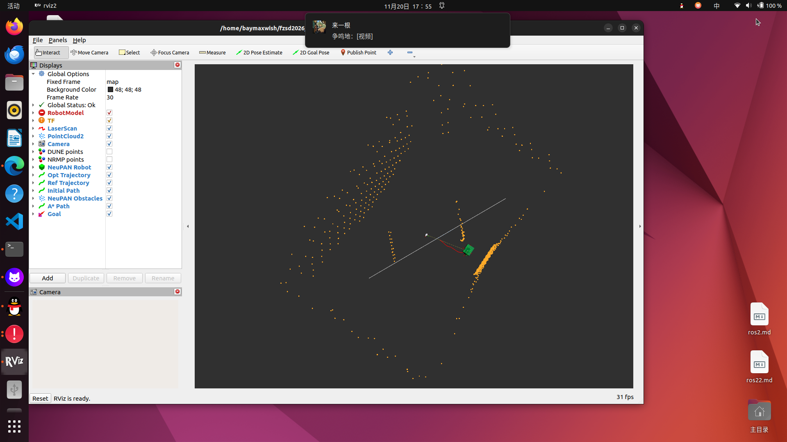
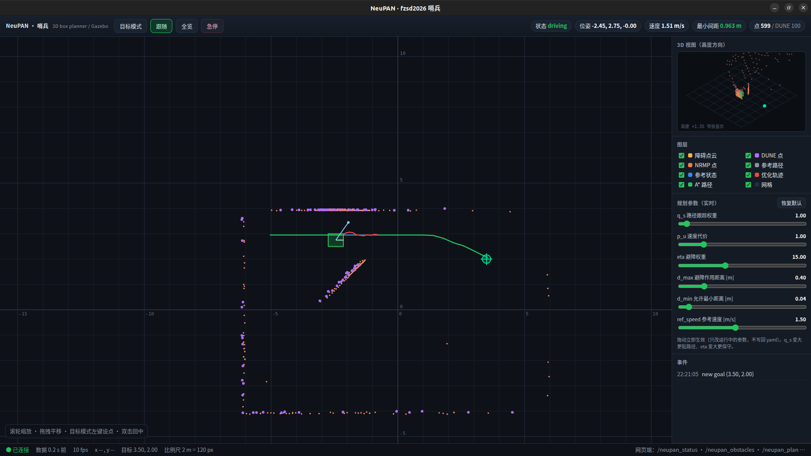
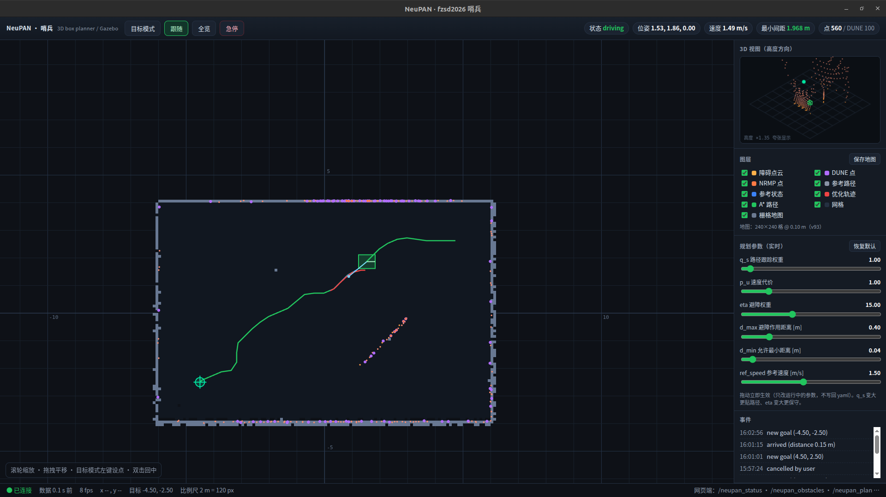

# fzsd2026 哨兵机器人 · NeuPAN 3D 局部规划

本目录把 [NeuPAN](https://github.com/hanruihua/neupan) 局部规划器接到 fzsd2026 哨兵机器人上，
并用一个 ROS 2 节点把它和 RoboMaster Gazebo 仿真（`rmul_2025` 场地）打通：

```
  静态地图 / A*（可选）          里程计 odom                  3D 激光 livox/lidar
        │                            │                              │
        ▼                            ▼                              ▼
  ┌──────────────────────────────────────────────────────────────────────┐
  │ neupan_ros2_bridge.py                                                │
  │   · 点云 → “地面坐标系”（z=0 为地面），滤地面/滤自车                        │
  │   · 滚动占据栅格（可选 A* 参考路径 / 卡死时侧向绕行）                      │
  │   · NeuPAN 3D 盒模型 (0.6×0.5×0.5 m) 每 20 ms 求解                        │
  │   · 发布 chassis_cmd、参考/优化轨迹、DUNE/NRMP 采样点、滤波后点云、TF        │
  └──────────────────────────────────────────────────────────────────────┘
        │                            │                              │
        ▼                            ▼                              ▼
  <robot_ns>/robot_base/chassis_cmd   /neupan_*  话题（RViz）      map→odom→base_footprint
        │                            │
        │                            └──────────► web/web_server.py ──► 浏览器
        │                                         （JSON + SSE）        http://127.0.0.1:8088/
        ▼                                                                 ▲
  rmoss_gz_base（底盘控制器） → Gazebo MecanumDrive2 → 机器人运动          │
        └──────────── /goal_pose /neupan_cancel ◄─────────────────────────┘
```

目录结构：

```
example/fzsd2026/
├── neupan_ros2_bridge.py     ROS 2 桥接节点（雷达→NeuPAN→底盘，核心）
├── planner.yaml              3D 盒模型 NeuPAN 配置
├── bridge_params.yaml        桥接节点参数
├── web/                      网页端（web_server.py + static/index.html）
├── model/                    3D DUNE 训练权重
├── map/                      扫描出的仿真地图（实验性）
├── img/                      README 用的截图
├── run_sim.sh / stop_sim.sh  一键启动 / 关闭仿真 + 桥接 + 网页
├── run_web.sh                只启动网页端
├── check_all.sh              验收脚本（4 个场景）
├── smoke_test_irsim.py       irsim 离线回归
├── test_sim_goal.py          仿真单目标点验收
├── test_sim_dynamic.py       仿真动态绕障验收
├── local_grid.py             滚动占据栅格 + A*
├── global_planner.py         静态地图 A*
├── build_map_from_lidar.py   用仿真扫描出地图（实验性）
└── run_demo*.py              irsim 可视化演示
```



*RViz（`map` 坐标系）：橙色为桥接节点送给 NeuPAN 的障碍点云，绿色盒子为机器人盒模型，
白线为参考路径，细线为 MPC 优化轨迹，箭头为当前目标点。*

## 1. 环境

* ROS 2 Humble + Ignition Gazebo 6（`ign gazebo 6.18`）
* 工作区：`~/fzsd2026`，已 `colcon build` 出 `install/setup.bash`
* Python 依赖：`torch`、`cvxpy`、`numpy`、`scipy`、`PyYAML`、`irsim`（仅 irsim 演示需要）

```bash
cd ~/fzsd2026
colcon build --symlink-install            # 首次或改动 C++ 包后
source install/setup.bash
```

## 2. 一键跑起来

```bash
cd src/NeuPAN/example/fzsd2026

./run_sim.sh                 # 无界面 Gazebo + 两台机器人 + NeuPAN 桥接（自动沿 planner.yaml 路线行驶）
./run_sim.sh --rviz          # 同上，并打开 RViz（推荐：能看到点云、DUNE/NRMP 点、轨迹）
./run_sim.sh --wait          # 不自动跑 yaml 路线，等 /goal_pose
./run_sim.sh --goal 5.0 -1.0 0.0   # 启动后直接去指定目标点

./stop_sim.sh                # 关掉上面启动的一切
```

RViz 里用工具栏 **2D Goal Pose** 点一个目标点即可重新规划；`map` 为固定坐标系。
也可以通过命令行发目标：

```bash
ros2 topic pub --once /goal_pose geometry_msgs/msg/PoseStamped \
  "{header: {frame_id: map}, pose: {position: {x: 5.0, y: -1.0}, orientation: {w: 1.0}}}"
```

日志在 `/tmp/neupan_run/`（可用 `NEUPAN_LOG_DIR` 改）：

| 文件 | 内容 |
| --- | --- |
| `gazebo.log` | Gazebo server |
| `spawn.log` | 机器人生成、ros_gz_bridge |
| `neupan_bridge.log` | 规划器状态（位姿、最小间距、速度、重规划事件） |

> **为什么要 `-s`（无界面）启动 Gazebo？**
> 这台机器上把 GUI 和 server 放进同一个进程时，Gazebo 6 的 Sensors 系统不发布
> `livox/lidar` 与相机话题（雷达恒无数据）。用 `ign gazebo -s` 单独跑 server 时一切正常，
> 因此 `run_sim.sh` 默认无界面；需要看场景时加 `--gui`（只挂一个 viewer）或用 RViz。

## 3. 直接只启动桥接（仿真已在运行时）

```bash
python3 example/fzsd2026/neupan_ros2_bridge.py --ros-args \
    --params-file example/fzsd2026/bridge_params.yaml
```

常用参数覆盖（`-p 名字:=值`）：

| 参数 | 默认 | 说明 |
| --- | --- | --- |
| `robot_ns` | `red_standard_robot1` | 机器人命名空间（话题前缀） |
| `planner_config` | `planner.yaml` | NeuPAN 配置文件 |
| `control_rate` | `50.0` | 规划/控制频率 Hz |
| `lidar_height` | `0.44` | 雷达离地高度 [m]；`0` = 用点云自动估计 |
| `ground_clearance` | `0.06` | 低于该离地高度的点视为地面丢弃 |
| `max_points` | `600` | 送入 DUNE 的最大点数 |
| `max_linear_speed` | `1.5` | 线速度上限 [m/s]（0 = 用 planner.yaml） |
| `goal_tolerance` | `0.35` | 判定到点距离 [m] |
| `use_startup_waypoints` | `true` | 是否开机就沿 `planner.yaml` 的 waypoints 走 |
| `use_local_grid` | `true` | 维护滚动占据栅格（用于绕行方向评估） |
| `use_local_planner` | `false` | 用栅格 A* 直接生成参考路径（实验特性） |
| `use_global_planner` | `false` | 用静态地图 A* 生成参考路径 |
| `global_map` | `''` | 地图 yaml（`use_global_planner=true` 时必填） |
| `max_detours` / `detour_step` | `4` / `0.9` | 卡死时侧向让开的次数与步长 [m] |

## 4. 网页端（把 RViz 搬到浏览器）



```bash
./run_sim.sh --web            # 仿真 + 桥接 + 网页端（打印 http://127.0.0.1:8088/）
# 或者只要网页端（仿真/桥接已在跑，或上实车）：
./run_web.sh                  # http://127.0.0.1:8088/
./run_web.sh --port 8090      # 换端口
```

浏览器打开后就是一张实时俯视图，内容和 RViz 一致：

| 区域 | 内容 |
| --- | --- |
| 主画布 | 障碍点云（按高度着色）、DUNE/NRMP 采样点、参考路径（虚线）、参考状态（蓝）、MPC 优化轨迹（红）、A* 路径（绿）、机器人盒模型 + 速度箭头、目标点 |
| 右上 3D 视图 | 同一场景的高度方向投影（机器人盒子、点云高度、目标点），直观看出这是 **3D** 盒模型规划 |
| 状态条 | 状态（driving/idle/arrived/failed）、位姿、速度、最小障碍间距（<0.15 m 变红）、点数 / DUNE 点数 |
| 事件 | 最近的目标、到点、卡死绕行、急停等事件 |
| 交互 | 滚轮缩放、拖拽平移、`目标模式`（快捷键 G）后左键点地图设点、双击回中、`全览`、`跟随`（F）、`急停`（S） |
| 规划参数 | 6 个滑条实时调 NeuPAN：`q_s`（贴路径程度）、`p_u`（速度代价）、`eta`（避障权重）、`d_max`/`d_min`（避障距离）、`ref_speed`（参考速度）；拖动立即生效，**恢复默认**按钮回到 `planner.yaml` 的值 |

### 实时调参（为什么有用）

障碍物很宽、偏离参考路径很大时，NeuPAN 会左右抽搐、原地打转 —— 本质是“贴路径”（`q_s`）和“避障”
（`eta` / `d_max`）两个代价在打架，加上参考路径本身穿过了一条 1.5 m 宽的缝（车宽 0.5 m，余量很小）。

这次做了三件事：

1. **参考路径带净空约束**（就是你说的全局约束）：在滚动占据栅格上做 A*，按 `local_inflation`（默认 0.45 m，
   可调到 0.6~0.7）膨胀，比车宽还窄的缝**不会**进参考路径；路径再做 Chaikin 平滑，避免栅格锯齿。
2. **抽搐/卡死检测与恢复**：指令在动但位移很小、或指令方向频繁反转 → 判为无进展；恢复顺序是
   “带净空重规划 → 原地倒车脱困（检查后方净空）→ 侧向绕行 → 重新锚定 → 安全停车”。
3. **参考路径抗抖动**：新规划与当前路径同方向时不替换；靠近机器人 0.8 m 内的路径点不参与“被挡”判断。

网页端的 6 个滑条就是给这套参数做在线的“手感实验”用的。以 `(3.66,-2.02) → (-3.64,2.02)`（两块板之间穿梭）
为例，同一份代码单次测量的量级（每次结果有波动，仅供对比）：

| 设置 | 到达 | 用时 | 轨迹 / 直线 | 抽搐窗口 | 现象 |
| --- | --- | --- | --- | --- | --- |
| `q_s=1`（默认） | 是 | 15~18 s | 23~26 m / 8.3 m（≈3×） | 0 | 绕远但稳，不再原地抽搐 |
| `q_s=4` | 多数能到 | 13~16 s | 23 m 左右 | 0~13 | 更贴路径，但在窄缝处容易挤住 |
| `q_s=10` | 否 | — | — | 0 | 太贴路径，卡在障碍前 |
| `local_inflation=0.7` | 是 | 17~18 s | 24 m | 0 | 净空更大（最近 0.12~0.26 m），路线更“保守” |
| `local_inflation=0.9` | 否 | — | — | 38 | 膨胀太大，A* 无解，回退直连后抽搐 |

建议：先保持默认（能到点、不抽搐），想更贴路径就把 `q_s` 加到 2~4 并观察是否在缝里挤住；
想更保守就把 `local_inflation` 提到 0.6~0.7（**这个是桥接参数，需要重启桥接**，网页上只有 `q_s/eta/d_max` 等）。
不合适点 **恢复默认** 立刻回到 `planner.yaml` 的值。

> 说明：这两块板之间剩下的“绕远”主要是**场景本身**——直连 8.3 m 要穿过 1.5 m 的缝，
> 而谨慎路线（绕开板子）本来就要 20 m 以上；现在机器人是稳定地走这条长路线，而不是在原地抽。
> 想压缩这段距离，就得靠上面这几个参数在“贴近缝”和“安全”之间找平衡。

实现说明：

* 后端 `web/web_server.py` 是一个 rclpy 节点 + Flask（`threaded=True`）：
  订阅 `/neupan_status`（桥接节点 20 Hz 发的 JSON 汇总）、`/neupan_obstacles`、
  `/neupan_plan`、`/neupan_ref_state`、`/neupan_initial_path`、`/neupan_global_path`、
  `/dune_point_markers`、`/nrmp_point_markers`，合成一帧 JSON 用 SSE 推给浏览器；
  点云抽稀到 350 点（`--cloud-max`）、限速 10 Hz（`--point-rate`），一帧约 10–20 KB。
* 前端是一个自包含的 HTML（无外部 CDN、无构建步骤），Canvas 2D 画俯视图和等轴测 3D 视图。
* 网页端只读规划器话题、只写 `/goal_pose` 和 `/neupan_cancel`，不直接碰底盘，
  所以桥接不启动时它也能安全地空转。

## 5. SLAM 栅格地图（边跑边建图）

桥接节点已经在发“滤掉地面、滤掉自车、地面坐标系”的障碍点云（`/neupan_obstacles`），
配合里程计就足够建一张 2D 栅格图：`web/map_builder.py` 用射线投射做 free-space carving，
log-odds 累积后发布标准 `nav_msgs/OccupancyGrid`（RViz / nav2 都能直接看），还能存成
map_server 的 `pgm/yaml`，给全局 A* 用。



```bash
# 1) 一边跑一边建图（网页上会实时出现灰色墙体）
./run_sim.sh --slam --web --nav-only
#    让车跑一圈，或者在网页上点目标点跑几趟；地图会自动累积

# 2) 网页“图层”卡片右上角点【保存地图】→【加载为全局图】即可立刻用这张图规划（不用重启）；
#    或者用命令行：
ros2 topic pub --once /neupan_save_map std_msgs/msg/String \
  "{data: '$PWD/map/rmul_2025_slam'}"

# 3) 带着地图跑：全局 A* 用这张图规划整条路线
./run_sim.sh --web --wait --gmap map/rmul_2025_slam.yaml
```

| 接口 | 说明 |
| --- | --- |
| `GET /api/map` | 当前地图（下采样到 0.1 m、RLE 压缩，约 1k 段，前端一次性转成离屏画布） |
| `POST /api/map/save` | `{"name": "rmul_2025_slam"}` → 保存到 `map/<name>.pgm/.yaml` |
| `POST /api/map/load` | `{"path": "rmul_2025_slam.yaml"}` → 立刻把这张图交给全局 A*（不用重启节点） |
| `/neupan_map` | 实时 `OccupancyGrid`（0.05 m，480×480） |
| `/neupan_save_map` | `String` 消息 = 保存前缀（绝对路径） |
| `/neupan_reset_map` | `Empty`，清空地图 |

实测（`rmul_2025` 场地，5 个位姿扫一遍）：1421 个占据格（0.05 m），墙体连续；
在这张图上 A* `(-3,-2) → (4.5,2.5)` 得到 9.85 m 路径；把地图交给桥接后
`(-5,3) → (4.5,2.5)` 走的是 **global A\* (map)** 的 30 点路线，13 s 到点。
未知区域在全局规划里按“自由”处理（乐观假设），所以建图要跑够一圈。

## 6. 验证结果

以下都是本机实测（`rmul_2025` 场地，红方出生点 `(-5.0, 3.0)`）。

| 用例 | 命令 | 结果 |
| --- | --- | --- |
| irsim 离线回归 | `python3 example/fzsd2026/smoke_test_irsim.py` | 600 步内到点，最近障碍 0.40 m，退出码 0 |
| 栅格 A* 自检 | `python3 example/fzsd2026/local_grid.py` | 绕墙 13.33 m（直线 10 m），自检通过 |
| 仿真直行到点 | `./run_sim.sh` | `(-5,3) → (5,0)` 约 **9–10 s**，最小障碍间距 0.30 m，到点正常停车 |
| 仿真动态绕障 | `./run_sim.sh --wait` 后 `python3 example/fzsd2026/test_sim_dynamic.py` | 蓝车停在红车路径 `(3.27,-0.61)`，红车 **18–28 s** 绕行到 `(5.5,-1.5)`，两车最小中心距 **0.56–1.81 m**（多次运行），PASS |
| 仿真单目标点 | `./run_sim.sh --wait` 后 `test_sim_goal.py --goal -3 -2 0` | **5.4 s** 到点，3 s 后速度 0.000 m/s（确实停住） |
| 目标不可达（场地死角） | `test_sim_goal.py --goal 5 -4.5 0` | 尝试 4 次侧向绕行后安全停车（不撞、不顶死），打印 `still in collision after the detours` |
| SLAM 建图 + 全局规划 | `./run_sim.sh --slam --web` 扫一圈 → 保存 → `--gmap` 再跑 | 1421 个占据格（0.05 m）墙体连续；`(-5,3)→(4.5,2.5)` 走 **global A\* (map)** 的 30 点路线，13 s 到点 |
| 网页端收发 | `./run_sim.sh --web` 后浏览器/`curl` | `/api/health` 正常；网页发目标 `(-3,-3)` → 机器人 12 s 内到点；`/api/stop` → 立刻 `idle`、速度 0、目标清空 |

`test_sim_dynamic.py` 的判定：到达目标 **且** 两车中心距 > 0.55 m（对应盒模型不接触）。
四个场景可以用 `./check_all.sh` 一次性复跑（结束后自动关掉仿真）。

## 7. 测试脚本

```bash
source /opt/ros/humble/setup.bash && source ~/fzsd2026/install/setup.bash
cd ~/fzsd2026/src/NeuPAN/example/fzsd2026

python3 smoke_test_irsim.py                                  # 无需 ROS，irsim 闭环回归
python3 local_grid.py                                        # 占据栅格 + A* 自检
python3 test_sim_goal.py --goal 5 0 0 --timeout 60           # 仿真单目标点（含停车校验）
python3 test_sim_dynamic.py --goal 5.5 -1.5 --blocker-goal 1.5 1.5

python3 test_sim_twitch.py --start 3.66 -2.02 --goal -3.64 2.02   # 两块板之间穿梭
python3 web/spawn_wall.py --x 0 --y 1.5 --length 6 --boxes 8      # 摆一面 6 m 宽的墙
python3 web/spawn_wall.py --clear                                 # 清掉
bash web/bench.sh qs4 /tmp/planner_qs4.yaml                       # 换配置跑一轮并统计
```

`test_sim_goal.py` 会把轨迹写成 CSV（`--csv`，默认 `/tmp/neupan_goal_trace.csv`），
`test_sim_dynamic.py` 打印最小中心距并给出 PASS/FAIL。

## 8. NeuPAN 3D 改造说明（相对上游 1.3）

哨兵车体近似为 0.6×0.5×0.5 m 的盒子，因此把 NeuPAN 的“2D 多边形机器人 + 2D 点云”
扩展成“3D 盒子机器人 + 3D 点云”：

| 文件 | 改动 |
| --- | --- |
| `neupan/robot/robot.py` | `robot` 新增 `height` / `z_robot`；给了 `height` 时用盒模型（`shape="box"`、`G` 为 6×3 的半空间约束） |
| `neupan/util/__init__.py` | 新增 `gen_inequal_from_box()`（6 个面：±x/±y/±z）与 `get_transform_3d()` |
| `neupan/blocks/pan.py` | 点流变换按 `G.shape[1]` 区分 2D/3D：3D 时旋转绕 z 轴、平移带 `z_robot`，得到以**盒中心**为原点的点云 |
| `neupan/blocks/dune.py` | `ObsPointNet` 输入维度改为 `G.shape[1]`（3D 时 3），不再写死 2 |
| `neupan/blocks/nrmp.py` | `fa` 取 `lam[:2]`（平面状态只有 x/y 自由度）；`fb` 在 3D 时减去 `lam_z * z_robot` |
| `neupan/blocks/dune_train.py` | 数据生成支持 3 维（`data_range` 6 元）、旋转矩阵 3×3、支持断点续训（`resume_checkpoint` / `start_epoch`，含学习率对齐） |
| `neupan/neupan.py` | `scan_to_point` 对 3D 机器人自动把 2D 扫描抬到 `scan_height`（默认 `z_robot`）；`scan_to_point_velocity` 修正传感器外参变换方向并同样支持 3D；`init_from_yaml` 允许 `dune_checkpoint` 相对配置文件目录解析 |

坐标系约定（**重要**）：送入规划器的障碍点 `z` 以**地面为 0**、`z_robot` 是盒中心离地高度
（`planner.yaml` 里 `z_robot: 0.25`）。桥接节点负责把雷达点从“雷达系”换算到该“地面系”：

```
z_ground = lidar_height + z_lidar
```

`lidar_height` 默认 0.44 m（本仿真实测值，可用点云 0.5 分位数自动标定），
比 `base_footprint→front_mid360`（0.33 m）大，是因为本仿真场地地面比世界原点高约 0.11 m；
上实车时按实车雷达离地高度设置即可。

3D DUNE 权重已训练好并随仓库提供：

```
model/fzsd2026_sentry_3d/model_2000.pth        # planner.yaml 默认使用（6×3 盒模型）
model/fzsd2026_sentry_3d_1/  _3d_2/            # 继续训练的版本（含 results.txt 曲线）
model/fzsd2026_sentry/                         # 早期 2D 版本，仅作对照
```

重新训练：

```bash
cd src/NeuPAN
PYTHONPATH=$(pwd) python3 example/fzsd2026/dune_train_fzsd2026.py
```

脚本会自动找 `model/fzsd2026_sentry_3d/` 里最大 epoch 的 `model_*.pth` 续训；
续训会写到 checkpoint 所在目录（不会新建 `xxx_1` 目录），学习率按 `start_epoch`
自动对齐。也可以显式指定输出目录（`train.model_path`，相对路径优先按当前目录解析，
其次按配置文件目录解析），例如：

```python
planner.dune_train_kwargs.update(model_path='/tmp/dune_test', data_size=400,
                                 epoch=4, save_freq=2, valid_freq=2)
planner.train_dune()
```

已用一个 3 维数据的小规模训练 + 续训烟囱测试验证过（`(32, 3)` 输入层、`model_0/2/4.pth`）。

## 9. irsim 可视化演示（不依赖 ROS）

```bash
cd src/NeuPAN
python3 example/fzsd2026/run_demo.py              # 自动驶向 env.yaml 的目标点
python3 example/fzsd2026/run_demo_interactive.py  # 右键点地图设置新目标
```

`env.yaml` 是仿真环境（障碍物、机器人初始位姿、目标点），`planner.yaml` 是规划器配置；
两个 demo 都从机器人当前位姿到 `env.yaml` 的目标点生成参考路径。

## 10. 已知限制 / 注意事项

1. **宽障碍 / 偏离路径较大时的抽搐**：已经在桥接里加了“参考路径 A*（带 0.45 m 膨胀，窄于车宽的缝不进路径）+ 卡死检测 + 倒退脱困 + 靠近障碍自动降参考速度”，
   并且可以在网页端实时调 `q_s / eta / d_max / d_min` 观察效果（见第 4 节实测表）。仍无法通过时安全停车并报 `stuck (...)`。
2. **目标落在窄死角内时不会强行挤进去**：如 `(5.0,-4.5)`（蓝车与场地图元之间），
   机器人会尝试至多 `max_detours` 次侧向绕行，仍无法通过则安全停车并打印原因。
   发一个新目标即可重试。
2. **工作区里的静态地图与 Gazebo 世界对不上**：`pb2025_nav_bringup/map/simulation/rmul_2025.pgm`
   的原点/尺度不覆盖 Gazebo 世界坐标（实测 A* 从出生点到场地中部常无解），
   所以 `use_global_planner` 默认关闭；等拿到与仿真世界一致的静态地图（或用 nav2 的
   SLAM/定位建图）再打开，并把 `map` 与 `odom` 的固定变换交给定位模块。
   本目录提供了 `build_map_from_lidar.py`，用运行中的仿真扫描出一张 map_server 地图：
   ```bash
   ./run_sim.sh --wait &                                  # 桥接节点发布 /neupan_obstacles
   python3 build_map_from_lidar.py --output map/rmul_2025_sim
   ```
   它会在 5 个位姿上瞬移机器人并累积障碍点。**注意**：激光点在 0.05 m 分辨率下较稀疏，
   且会看到场地外部的结构，目前这类扫描图直接做 A* 仍可能找不到路径（工具默认会做
   0.15 m 膨胀，可用 `--dilate/--poses/--settle` 调），因此它只是给 A* 提供路网的起点，
   默认的“直连参考路径 + 卡死绕行”不依赖静态地图。
3. **本仿真的里程计就是世界坐标**：`/red_standard_robot1/chassis_odometry_gt` 的 x/y 与
   Gazebo 世界坐标一致（`z` 恒为 0），所以桥接把 `map→odom` 发布成单位变换。
   实车上若 `odom` 以开机点为原点，请让定位节点发布 `map→odom`，并把
   `use_startup_waypoints` / `startup_goal` 的坐标换算到 map 系。
4. **底盘是麦轮（omni）**：`planner.yaml` 里 `kinematics: 'omni'`，桥接发布 `(vx, vy)`；
   `ChassisCmd.VELOCITY` 的 `(vx,vy)` 由 `rmoss_gz_base` 旋转到云台系，云台保持 0 度时等价于车体系。
5. **重规划策略**：默认只用“直连参考路径 + 碰撞约束”，卡死（指令速度 > 0.25 m/s 但 1 s 内
   位移 < 0.05 m）或安全停车时，用滚动栅格评估左右两侧净空，插入一个侧向中间航点绕行。
   `use_local_planner: true` 可改成持续用栅格 A* 生成参考路径（实验特性，容易抖动）。

## 11. 修过的仿真侧问题

* `rmoss_gz_plugins/LightBarController` 原实现在应用灯光颜色时**删除并重建** `light_bar_visual`
  实体；Gazebo 6 的 Sensors 渲染线程会并发重建同名 visual，导致 headless 模式启动机器人时
  server 段错误（`SceneManager::CreateVisual`）。现改为**原地更新 `Material` 组件**，
  headless 与 GUI 都稳定。改动在
  `src/fzsd2026_gazebo_simulator/rmoss_gazebo/rmoss_gz_plugins/plugins/light_bar_controller/LightBarController.cc`，
  需要 `colcon build --packages-select rmoss_gz_plugins`。
* 如果 `colcon build --symlink-install` 对某个 Python 包报 `error: option --editable not
  recognized`（本机 2026-11-21 之后 `sdformat_tools` 就中过这个），删掉该包的
  `build/<pkg>` 和 `install/<pkg>` 再 `colcon build --packages-select <pkg>`（不加
  `--symlink-install`）即可；否则 `spawn_robots` 会报 `ModuleNotFoundError: sdformat_tools`。
* `run_sim.sh` 已把 `IGN_GAZEBO_RESOURCE_PATH` 补齐到 `fzsd2026_robot_description` 的
  `resource/models`，否则 `spawn_robots` 找不到 `model://rplidar_a2/...`。

## 12. 文件清单

| 文件 | 说明 |
| --- | --- |
| `neupan_ros2_bridge.py` | ROS 2 桥接节点（核心） |
| `bridge_params.yaml` | 桥接节点参数 |
| `planner.yaml` | NeuPAN 配置（3D 盒模型、DUNE 权重、代价参数） |
| `env.yaml` / `run_demo*.py` | irsim 演示 |
| `global_planner.py` | 静态地图 A*（可选） |
| `build_map_from_lidar.py` | 用运行中的仿真扫描出 map_server 地图（实验性） |
| `test_sim_twitch.py` | “两块板之间穿梭/原地抽搐”回归测试 |
| `web/spawn_wall.py` | 在仿真里摆一面可调的墙（做宽障碍实验） |
| `web/map_builder.py` | SLAM-lite：把 `/neupan_obstacles` 累积成栅格地图，发布/保存 |
| `map/rmul_2025_slam.*` | 扫出来的场地地图（可直接 `--gmap` 使用） |
| `web/bench.sh` / `web/analyse_run.py` | 换参数跑一轮 + 从 rosbag 统计轨迹质量 |
| `local_grid.py` | 滚动占据栅格 + A*（卡死绕行方向评估 / 实验参考路径） |
| `run_sim.sh` / `stop_sim.sh` | 一键启动 / 关闭 |
| `check_all.sh` | 四个验收场景（含网页端）一键复跑 |
| `test_sim_goal.py` / `test_sim_dynamic.py` | 仿真验收脚本 |
| `web/web_server.py` | 网页端后端（ROS 话题 ⇄ JSON/SSE/HTTP） |
| `web/static/index.html` | 网页端前端（Canvas 俯视图 + 3D 视图，自包含） |
| `run_web.sh` | 只启动网页端 |
| `neupan.rviz` / `img/` | RViz 配置（`map` 坐标系）、截图 |
| `model/` | DUNE 训练权重与训练记录 |
